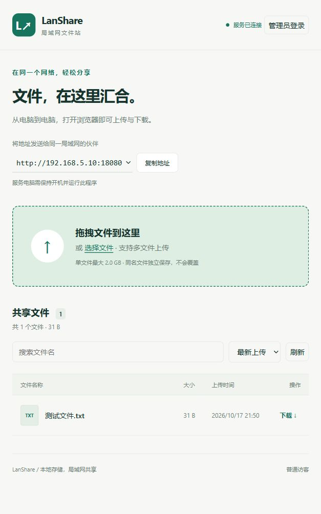

# LanShare 局域网文件站

C# / ASP.NET Core 10 / Kestrel 实现，网页资源内嵌。发布包包含 .NET 运行时，目标机器无需安装 .NET、Python、Node.js、IIS、数据库或访问互联网。

**[下载最新版本](https://github.com/fzj929/LanShare/releases/latest)** · **[详细使用指南](docs/USAGE.md)** · **[v1.0.0 测试与兼容性说明](docs/VALIDATION.md)**

一台电脑启动程序，同一局域网的其他设备通过浏览器上传和下载。默认端口 `8080`，默认单文件上限 2 GiB。上传文件保存在服务电脑，程序重启后仍可访问。



## 快速开始

1. 从 Releases 下载与你的操作系统和 CPU 架构对应的压缩包，**不是 GitHub 自动生成的 Source code**。
2. Windows 完整解压后双击 `Start-Windows.cmd`；Linux 解压后运行 `sh start-linux.sh`。
3. 本机打开 `http://localhost:8080`，其他设备打开程序显示的 `http://局域网IP:8080`。
4. 首次运行自动创建 `lanshare.json` 和 `data/`。管理员密码显示在启动窗口中。需要限制访问时，停止程序，在配置中设置 `accessPassword`，然后重启。

启动窗口或终端需要保持运行。Windows 的防火墙放行、Linux 的防火墙配置和网络故障排查见[详细指南](docs/USAGE.md)。

## 选择版本

| 发布包 | 系统 |
|---|---|
| win-x64 | Windows x64（如 Windows 10 22H2、Windows 11） |
| linux-x64 | 采用 glibc 的 Linux x64 |
| linux-arm64 | 采用 glibc 的 Linux ARM64 / aarch64，64 位系统 |
| linux-arm | 采用 glibc 的 Linux ARM32 / ARMv7 hard-float，32 位系统 |

ARM32 包不适用于 ARMv6 或软浮点系统。请依据操作系统位数而不只是 CPU 型号选择。Linux 推荐 Debian 12/13、Ubuntu 22.04/24.04 或相应版本 Raspberry Pi OS；具体支持范围以微软 .NET 10 支持清单为准。Alpine/musl 不在这四个包的适用范围内。

“自包含”免除 .NET 安装，不会取消 Linux 的操作系统基础库要求（glibc、libstdc++、libgcc、zlib、OpenSSL 等）。本项目启用 invariant globalization，免除 ICU 依赖。单文件首次运行会将原生库解压到用户的 .net 缓存目录，需有可写且允许加载库的目录。

## Windows 启动

1. 将 ZIP 完整解压到有写入权限的文件夹，例如 `D:\LanShare`，不要直接在压缩包内运行。
2. 双击 `Start-Windows.cmd` 或 `LanShare.exe`。程序将打开本机浏览器；关闭启动窗口会停止服务。
3. 复制网页中显示的局域网地址给其他电脑，例如 `http://192.168.5.10:8080`。
4. 若防火墙提示，请允许专用网络。也可在管理员 PowerShell 中执行 `powershell -ExecutionPolicy Bypass -File .\Allow-Lan-Windows.ps1`，仅开放本地子网访问此程序的 TCP 8080 端口。修改端口时需传入 `-Port 端口号`。此脚本不会自动运行。

## Linux 启动

```sh
mkdir -p ~/LanShare
tar -xzf LanShare-linux-arm64.tar.gz -C ~/LanShare
cd ~/LanShare
sh start-linux.sh
# 或 chmod +x LanShare && ./LanShare --no-browser
```

程序使用普通用户运行即可。首次启动生成配置和数据目录。按 Ctrl+C 退出。在桌面 Linux 中是否能双击可执行文件取决于桌面环境；终端中的启动脚本是通用方式。若启用了 UFW，可由管理员按实际局域网网段放行，例如 `sudo ufw allow from 192.168.5.0/24 to any port 8080 proto tcp`。

## 功能

- 多文件选择、拖拽上传、逐文件进度、失败重试。浏览器按队列依次上传，服务器最多接收 4 个并发上传请求。
- 文件搜索、按名称/大小/时间排序、附件下载。下载支持 HTTP Range。
- 同名文件独立保存，不覆盖已有文件。原文件名保留在元数据中，实际磁盘路径使用随机 ID。
- 流式接收文件，边接收边写入磁盘。上传完成后才进入列表，中断不会留下可下载的半成品。
- 可选访问密码。管理员密码首次自动生成并保存在配置文件，启动窗口显示该密码。
- 仅管理员可删除。会话有效期 12 小时，重启服务后需重新登录。

## 配置

第一次运行会在程序旁生成 `lanshare.json`。停止程序后可修改，再重新启动：

```json
{
  "port": 8080,
  "dataDirectory": "data",
  "maxFileSizeMB": 2048,
  "openBrowser": true,
  "accessPassword": "",
  "adminPassword": "首次运行自动生成，请保管"
}
```

- `dataDirectory`：相对路径以可执行文件所在目录为基准，也支持绝对路径。
- `maxFileSizeMB`：单文件限制，按 1024×1024 字节计算，默认 2 GiB。
- `accessPassword`：为空时局域网用户可直接上传、下载；设置后需要登录。
- `adminPassword`：具有删除权限的管理员密码；无需对普通使用者公开。
- `openBrowser`：仅 Windows 自动打开浏览器；也可传 `--no-browser` 禁用。
- 环境变量 `LANSHARE_PORT`、`LANSHARE_DATA_DIR`、`LANSHARE_ACCESS_PASSWORD`、`LANSHARE_ADMIN_PASSWORD` 可临时覆盖配置。

更新程序时保留 `lanshare.json` 和完整 `data` 文件夹，替换可执行文件即可。备份请备份整个 data 文件夹（含 metadata.json 和 content.bin），不要只复制 content.bin。异常断电可能在 data/staging 留下未完成内容；停止服务后可清理 staging，不能在上传时清理。

## 局域网访问

服务监听所有接口的指定端口，网页优先显示带网关的 IPv4 地址并过滤常见 Clash 测试网段。多网卡时请选与其他电脑处于同一网段的地址。不需要公网 IP、域名或端口转发。网络隔离、访客 Wi-Fi、客户端隔离、防火墙可能阻止设备间通信。建议路由器为服务电脑保留 IP。

本版本默认使用 HTTP，密码与文件没有传输加密，适用于可信局域网，不适合直接映射到公网。设置访问密码后仍须使用可信网络；如需加密，可在后续版本配置 HTTPS。

## 重新构建

构建机需要 .NET 10 SDK、用于打包的 Python 3，以及首次还原运行时包所需的网络；使用者的目标机器不需要这些开发工具。

```powershell
.\scripts\publish.ps1
# 或传入 dotnet.exe 的完整路径
.\scripts\publish.ps1 -Dotnet 'C:\Program Files\dotnet\dotnet.exe' -Python 'python'
```

Linux 构建机执行 `sh scripts/publish.sh`。打包只使用 Python 标准库，不需要安装第三方 Python 包。结果在 artifacts 中，Linux 压缩包会保留正确的可执行权限。未启用 Native AOT，可从 Windows 交叉发布四个目标。所有包都使用 self-contained + single-file + IncludeNativeLibrariesForSelfExtract，默认未裁剪。

### 源码运行

```sh
dotnet run --project LanShare.csproj --self-contained false -p:PublishSingleFile=false -- --no-browser
```

也可只发布指定平台：

```sh
dotnet publish LanShare.csproj -c Release -r linux-arm64 --self-contained true -o artifacts/linux-arm64
```

### 运行开发测试

集成测试只使用 Python 标准库，属于开发工具；最终用户无需安装 Python：

```powershell
# 构建 Windows 版本后，测试实际独立 EXE
python scripts/integration_test.py artifacts/win-x64/LanShare.exe
```

测试会启动临时服务并验证上传下载哈希、中文与同名文件、大小限制、Range 下载、上传中断清理、重启持久化和密码权限。测试临时文件在系统临时目录创建并在结束后清理。

## 参考

- https://learn.microsoft.com/dotnet/core/deploying/single-file/overview
- https://github.com/dotnet/core/blob/main/release-notes/10.0/supported-os.md
- https://learn.microsoft.com/aspnet/core/fundamentals/servers/kestrel/

交叉发布成功不代表已在实际 ARM 设备运行验证。当前发布包的测试范围见 [VALIDATION.md](docs/VALIDATION.md)。
